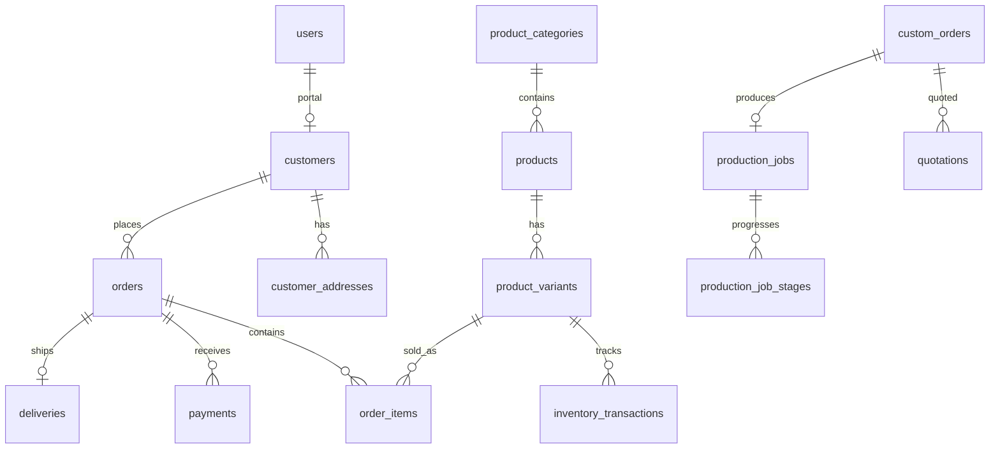

# Database Design — Aster

## Conventions

- Money: `DECIMAL(12,2)`  
- Foreign keys with indexes on hot lookup columns  
- Soft deletes only where business-safe (e.g. products); protect paid orders  
- Timestamps on all tables  
- Order line snapshots preserve historical name/SKU/price  

## Phase 1 tables

| Table | Purpose |
|-------|---------|
| `users` | Auth accounts (staff + customer portal) |
| Spatie permission tables | Roles & permissions |
| `customers` | CRM profile; optional `user_id` |
| `customer_addresses` | Delivery/billing addresses |
| `business_settings` | Key/value brand & operational config |
| `notifications` | Laravel database notifications |
| `sessions`, `cache`, `jobs` | Framework defaults |

## Planned core entities (Phases 3+)

`product_categories`, `products`, `product_images`, `product_variants`, `product_attributes`, `product_attribute_values`, `suppliers`, `purchases`, `purchase_items`, `inventory_locations`, `inventory_transactions`, `carts`, `cart_items`, `wishlists`, `wishlist_items`, `orders`, `order_items`, `order_status_histories`, `payments`, `payment_methods`, `custom_orders`, `custom_order_measurements`, `custom_order_images`, `quotations`, `production_jobs`, `production_stages`, `production_job_stages`, `deliveries`, `delivery_zones`, `promotions`, `coupons`, `coupon_usages`, `reviews`, `newsletter_subscribers`, `social_media_posts`, `expenses`

## ERD (foundation + commerce sketch)

## Inventory transaction rules

Every stock change records: variant, previous qty, delta, new qty, type, reason, user, timestamp. Negative stock blocked unless `allow_negative_stock` setting is enabled.
